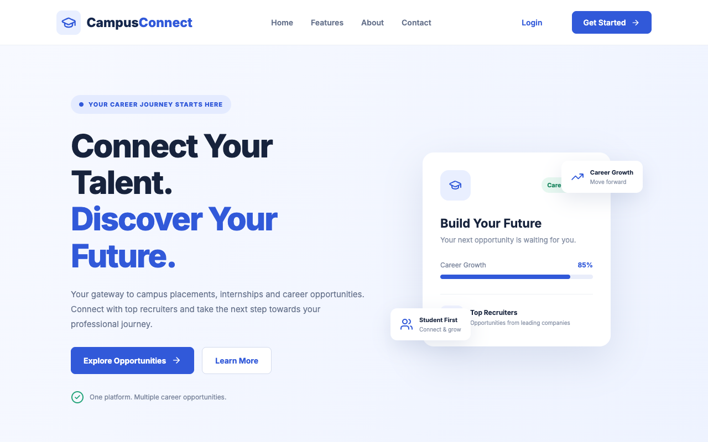
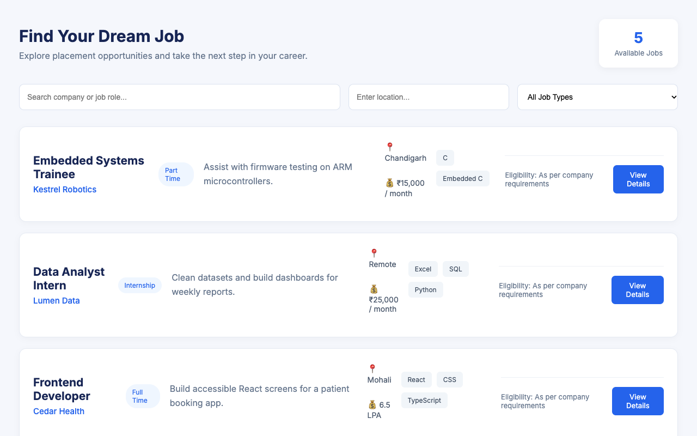
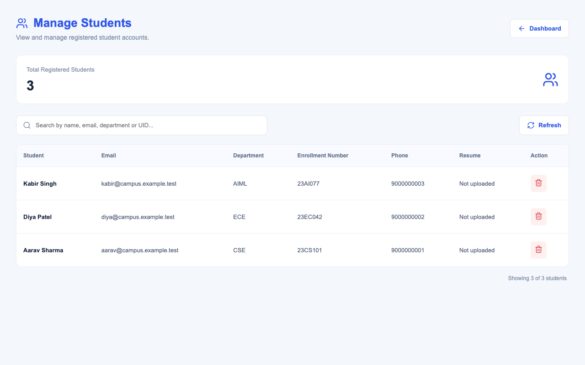

# CampusConnect

A campus placement portal. Students register, search open jobs and upload their resume as a PDF. Admins post jobs, manage student accounts and open students' resumes.

The API is an Express app running on **AWS Lambda** behind **API Gateway**, with **Amazon DynamoDB** for data and a private **Amazon S3** bucket for resumes. All of it is defined in one **AWS SAM** template, [`template.yaml`](template.yaml).

> **Status:** not deployed at the moment. The SAM template is ready and deployment is waiting on a new AWS account. Everything except resume upload runs locally with Docker (see [Run locally](#run-locally)).

| Home | Find Jobs | Manage Students (admin) |
| --- | --- | --- |
|  |  |  |

Screenshots are from a local run with sample data.

## Features

- **Accounts and roles**: students sign up themselves. The first admin is created once with a secret setup key. Logins return a JWT that the frontend sends as a bearer token; passwords are hashed with bcrypt.
- **Unique emails without a unique index**: DynamoDB has no unique constraint, so registration writes the user and an `EMAIL#<email>` lock item in one transaction. Two sign-ups with the same email can't both succeed, even at the same moment.
- **Jobs**: admins post jobs. Anyone can browse open jobs, newest first, search by company or role, and filter by location and job type.
- **Resumes on S3**:
  1. The browser asks the API for a signed upload form that allows one PDF, up to 5 MB, for 5 minutes.
  2. The PDF goes straight from the browser to the private bucket, never through Lambda.
  3. The API checks the size and the `%PDF-` file signature before saving it to the profile, and deletes anything else.
  4. Resumes are opened through signed links that expire after 5 minutes. Deleting a student also deletes their resume.
- **Admin student list**: search, refresh, delete and view resumes.
- **Data migration**: [`backend/scripts/migrate-from-atlas.js`](backend/scripts/migrate-from-atlas.js) copies users and jobs from the earlier MongoDB Atlas version into DynamoDB.

The stat cards on both dashboards and the student dashboard's "Recommended Opportunities" list are fixed placeholder values in the UI, not live data yet.

## Architecture

```
Browser (React + Vite)
   │  REST + JWT                         signed upload form / signed link
   ▼                                                │
API Gateway ──► Lambda: Express app (serverless-http) ──► DynamoDB
                     │                                    users  (index role-createdAt)
                     │                                    jobs   (index status-createdAt)
                     └── checks uploads ──► S3 (private bucket, resumes/) ◄─┘
```

- [`backend/lambda.js`](backend/lambda.js) wraps the Express app for Lambda; [`backend/server.js`](backend/server.js) runs the same app on a normal port for local development.
- The two secondary indexes answer the list pages (all students, open jobs) without scanning a whole table.
- Search uses lower-case copies of company, role and location, because DynamoDB's `contains()` is case-sensitive.
- On a normal AWS account the template creates a least-privilege IAM role: logs, the two tables, and files under `resumes/` only.

More detail, including the reasons for each choice, is in [AWS_SETUP.md](AWS_SETUP.md#how-it-works-useful-for-a-viva).

## Tech stack

| Part | Tools |
| --- | --- |
| Frontend | React 19, React Router 7, Vite 8, axios, lucide-react |
| Backend | Node.js 22+, Express 5, serverless-http, AWS SDK v3, jsonwebtoken, bcryptjs |
| AWS | Lambda (Node.js 24), API Gateway, DynamoDB (on-demand), S3, IAM, SAM |
| Tests | Node's built-in test runner, DynamoDB Local, aws-sdk-client-mock for S3 |
| CI | GitHub Actions: backend tests, frontend lint and build |

## Run locally

You need Node.js 22 or newer and Docker. No AWS account is needed, except for resume uploads, which need the real S3 bucket.

```bash
cd backend
npm install
cp .env.example .env        # fill in JWT_SECRET and ADMIN_SETUP_KEY
npm run db:local            # terminal 1: DynamoDB Local on port 8000
npm run db:setup            # terminal 2: create the tables
npm run dev                 # API on http://localhost:5000
```

```bash
cd frontend
npm install
npm run dev                 # uses http://localhost:5000/api unless VITE_API_URL is set
```

Create the first admin with `POST /api/auth/create-admin` and your `ADMIN_SETUP_KEY` (see [AWS_SETUP.md](AWS_SETUP.md#7-create-the-first-admin)).

## Tests

```bash
cd backend
npm test                    # needs DynamoDB Local running on port 8000
```

13 tests cover sign-up and login (including two sign-ups with the same email at once), admin setup and student deletion, job posting rules and filters, the Lambda handler and CORS, and resume upload checks. A 14th test for the Atlas copy runs only when `TEST_MONGO_URI` points at a MongoDB.

## Deploy to AWS

`sam build` and `sam deploy --guided`, step by step in [AWS_SETUP.md](AWS_SETUP.md). It also covers Learner Lab accounts and removing everything again with `sam delete`.

## API

| Method | Path | Who |
|---|---|---|
| POST | `/api/auth/register` | anyone (creates a student) |
| POST | `/api/auth/login` | anyone |
| POST | `/api/auth/create-admin` | once, with the admin setup key |
| GET | `/api/jobs` (`?search=&location=&jobType=`) | anyone |
| GET | `/api/jobs/:id` | anyone |
| POST | `/api/jobs` | admin, recruiter |
| GET | `/api/admin/students` | admin |
| DELETE | `/api/admin/students/:id` | admin |
| GET | `/api/admin/students/:id/resume` | admin |
| POST | `/api/students/me/resume/upload-url` | student |
| POST / GET / DELETE | `/api/students/me/resume` | student |

Requests that need a login send `Authorization: Bearer <token>`.

## Credits

The first version of CampusConnect (React frontend and an Express + MongoDB API) was built by Harsh ([Harsh-1826](https://github.com/Harsh-1826)). Lovish Gautam moved the backend to AWS (Lambda, DynamoDB, S3 and the SAM template) and added resume uploads, the Atlas migration script, the tests and CI.
